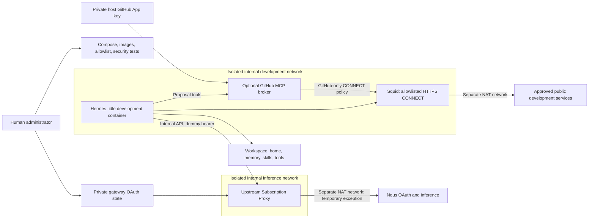

# Hermes DevLoop

A Docker Compose foundation for supervised Hermes development. The agent can
build its own tools in persistent storage, inspect a read-only project source
reference, and develop changes in a separate checkout. Live infrastructure and
provider credentials stay outside its mounts. No unattended agent loop starts.

Run **`./devloop`** for the interactive menu. First use follows **setup → login →
choose a model → chat**. Login guides browser approval and model selection;
subsequent sessions use the saved model.

```bash
./devloop
```

Every menu action is also available as a command:

| Action | Behavior |
| --- | --- |
| `setup` | Check prerequisites/subnets, preserve existing configuration, prepare storage, build and start |
| `start` / `stop` | Start or stop services while retaining data and credentials |
| `status` | Show service health, login readiness, selected model and next step |
| `login` / `logout` | Sign in through Nous, or clear only the gateway's local Nous authentication |
| `models` | List account models and select a persistent default; `--list` and `--select MODEL_ID` also work |
| `chat` | Launch interactive Hermes with the selected model; `--model MODEL_ID` overrides one session |
| `shell` | Open a shell in the development workspace |
| `logs` | Choose a service; optionally `--follow` and `--tail N` |
| `doctor` | Diagnose prerequisites, subnet conflicts, permissions and gateway/model-list connectivity |
| `test` | Run security checks; `--persistence` explicitly recreates containers, `--authenticated` checks real model access |
| `rebuild` | Build the pinned images and recreate services, retaining runtime data |
| `project` | Show/refresh the read-only committed source reference, or prepare a separate writable checkout |
| `github` | Configure the GitHub App, start its isolated MCP broker, or check reads and draft proposals; issue tools are available after broker activation |
| `help` | Show commands and examples |

The host tool uses only Python's standard library. The selected model lives in
private `runtime/devloop/settings.json`, outside Hermes' mounts, and contains no
credentials. Administration actions share a host-side lock; status and logs
remain available. Existing `.env`, workspace, gateway state and unknown model
settings are preserved. Setup creates `.env` from the example only if absent.

`status` checks local gateway readiness without fetching models. It explicitly
distinguishes stored credentials from verified provider access. `login`, `models`,
`chat` and an authenticated `doctor` check the current provider model list;
`chat` alone launches inference. Login, chat and shell require a real terminal.
Invoking `./devloop` without a terminal prints help and exits.

**Temporary exception approved by the human:** the stock LLM Subscription Proxy
has direct outbound networking. It does not yet support the required outbound
proxy routing. Its destinations are not independently filtered; a compromised
gateway could reach the internet, host, and LAN. Hermes itself retains strict
egress isolation. Adoption of [upstream PR #110083](https://github.com/NousResearch/hermes-agent/pull/110083)
is deferred until upstream support is available; this repository carries no
transport patch. See [the decision and risks](docs/infrastructure-review.md).

## Architecture



Hermes joins two `internal` Docker bridges using `gateway_mode_ipv4: isolated`.
Docker assigns no host IP to these bridges and gives Hermes no default route.
External DNS forwarding is unavailable to this internal-only container; its
system resolver also points to container loopback. IPv6 and IP forwarding are
disabled, all capabilities are dropped, and route changes/raw sockets are denied.
Squid and the gateway have IP forwarding disabled too, so neither provides an
IP-routing bypass. Proxy environment settings make clients functional; they are
not the enforcement boundary. See [Docker's isolated-mode documentation](https://docs.docker.com/engine/network/port-publishing/#gateway-modes).

Squid listens only on its internal address. It allows exact public destination
names on TCP 443 using CONNECT, rejects private/special-use destinations even
when an approved name resolves to them, and denies other traffic. The gateway
listens only on its inference-network address. No host ports are published.

## Files and ownership

| Path | Owner and container access |
| --- | --- |
| `compose.yaml`, `.env`, `infrastructure/`, `scripts/`, `tests/`, `docs/` | Human administration; never mounted into Hermes |
| `runtime/hermes/home/` | Hermes-writable home and its own application configuration |
| `runtime/hermes/workspace/` | Hermes-writable development workspace at `/workspace` |
| `runtime/hermes/memory/` | Hermes memory at `/home/hermes/.hermes/memories` |
| `runtime/hermes/skills/` | Hermes skills at `/home/hermes/.hermes/skills` |
| `runtime/hermes/tools/` | Executable development tools at `/home/hermes/tools` |
| `runtime/gateway/` | Gateway and human only; mounted at `/var/lib/gateway` in the gateway |
| `runtime/devloop/` | Human-managed model preference and administration lock; never mounted into a service |
| `runtime/reference/` | Human-exported committed project source, mounted read-only at `/reference`; excludes host Git metadata, local environment and runtime state |
| `infrastructure/squid/` | Human-owned policy, mounted read-only into Squid |
| `~/.config/hermes-dev-loop/github-app.pem` and `github-app.json` | Owner-only host files, mounted read-only only into the optional GitHub broker |

The whole `runtime/` tree and local `.env` files are Git-ignored. Separate bind
mounts expose only the listed paths, never the repository or runtime parent.
All containers run as UID/GID 1000, with a read-only root, `no-new-privileges`,
Docker's default seccomp profile, CPU/memory/process limits, and bounded log files.
There is no Docker socket, Docker-in-Docker, privileged container, or host network.

## Project access and proposed improvements

Hermes can inspect `/reference/hermes-dev-loop`, an export of the host repository's
committed HEAD. This includes the tracked infrastructure source for review, while
the live host checkout remains outside its mounts. Uncommitted edits, untracked
files, `.git`, local `.env` files and runtime credentials are excluded. Links and
protected tracked paths cause export to fail rather than expose their targets.
The Git-ignored export parent is mounted read-only, and host refreshes atomically
switch the reference to a newly generated snapshot. Old snapshots remain available
to existing readers; they can be cleaned up by the host administrator during downtime.

Choose **project** from `./devloop` for reference status, refresh or checkout
preparation. Setup and rebuild refresh the reference automatically. Direct commands:

```bash
./devloop project --refresh
./devloop project --checkout
```

Checkout preparation fetches the reference commit over HTTPS into
`/workspace/projects/hermes-dev-loop`, on branch `hermes/improvement`. An existing
checkout is preserved and must be managed from Hermes. A writable checkout allows
source edits; it does not grant control of the running infrastructure. Native
Docker/Compose boundary tests still require a human host administrator.

The dedicated GitHub App `hermes-dev-loop-bot` supplies the separate proposal
identity. Its optional broker uses GitHub's official MCP server for App
authentication and token refresh. Hermes receives a restricted, project-scoped MCP toolset for proposals, issue management and [read-only Actions diagnostics](docs/actions-diagnostics.md);
it receives neither the private key nor installation tokens. Reads work before
writes are enabled. Every proposal write checks GitHub's effective rules for an
active PR requirement on `main`: at least one approval, code-owner review, stale
approval dismissal, and explicit confirmation that the App cannot bypass it.
The repository keeps an empty bypass list, so the human follows the review rules
too. GitHub may hide that full list from the App; status reports its visibility.
The broker rejects writes to `main` and exposes no merge or approval operation.
Issue tools list/search/read full discussions, create issues, update title/body,
change existing labels and comment, with exact readback and durable replay guards.
No issue close/delete or label creation is exposed. See [the workflow](docs/hermes-project-workflow.md)
and [App setup, limits and explicit human canary](docs/github-app-broker.md#issue-management-and-replay-safety).

Choose **github** from `./devloop` for guided ID configuration and downloaded-key
import, or run `./devloop github --setup`. The tool stores the App metadata and PEM
in `~/.config/hermes-dev-loop/`, outside the repository. Only the broker receives
its two required files. The directory is mode `0700`; configuration and key files are `0600`.
It rejects fingerprints, malformed/encrypted/non-RSA keys and symlinks, and never
prints the key. Git ignores key files, and source exports reject key filenames
and PEM private-key headers even if accidentally committed. This is additional
protection against these key formats, not a general-purpose secret scanner.

After credential setup, use the **github** submenu to start/register the broker
and check the integration. Start a new Hermes chat to discover `github-devloop`.
Direct equivalents are:

```bash
./devloop github --start
./devloop github --check
./devloop github --proposal-test  # creates a disposable draft PR only if protection passes
```

Once enabled, normal `start`, `stop` and `rebuild` include the broker. It has no
default route, host port or workspace mount. Its Squid policy permits only
`api.github.com` and `raw.githubusercontent.com`; Hermes cannot directly reach
GitHub's API. Clients use `squid`, `llm-gateway-api` and `github-broker` DNS names.
The gateway API alias exists only on the inference network; upstream uses it for
both binding and Host-header validation. Fixed addresses remain in network
assignments and enforcement policy.

The ruleset gates approval before merge; it does not remove the App's underlying
Contents-write permission to merge an approved PR. The broker exposes no merge
operation. `.github/CODEOWNERS` assigns all files to `@sevandewater` and takes
effect when merged into `main`; GitHub uses the base branch's ownership file.
See [validation](docs/github-broker-validation.md) for live reads, denied
operations and proposal checks.

## Prerequisites

- A Linux Docker Engine **28 or newer**, with bridge firewalling enabled and
  support for isolated gateway mode. Tested versions are in the validation report.
- [Docker Compose 2.17 or newer](https://docs.docker.com/reference/compose-file/build/#additional_contexts), Python 3, and `iproute2` on the host for tests.
- The optional broker artifact is pinned for Linux amd64.
- Host user UID 1000. This initial slice fixes container ownership to that UID;
  changing it requires a coordinated image/Compose/runtime ownership update.
- Internet access during image builds, enough disk for Hermes dependencies and
  development toolchains, and a Nous Portal account for real inference.
- Unused `10.237.80.0/24` and `10.237.81.0/24` subnets. Docker rejects overlaps
  with its networks. Check LAN/VPN routes too before starting. These fixed
  addresses appear in Compose, Squid policy and tests;
  update them together if your host uses those ranges.

This targets native Linux Docker. Docker Desktop, rootless Docker, modified
Docker firewall backends, and other host kernels require their own runtime
validation; configuration validation alone does not qualify them.

## Initial setup

From the repository root, as UID 1000:

```bash
./devloop setup
```

Images use a digest-pinned Python base and Hermes source commit
`e55c2662f5ebfbd3a474ebf5e0e0c51187e70e39`. Python dependencies are installed
from that source's frozen lockfile with MCP, PTY, and aiohttp extras. Separate
Dockerfile targets share the pinned source/dependencies; the gateway omits the
development OS toolchain. OS packages
come from Debian's maintained repositories at build time; the complete OS
package graph is not snapshot-pinned.

Hermes starts as `sleep infinity`. The unauthenticated gateway also idles and
reports unhealthy because inference is unavailable. Squid must become healthy
before Hermes starts. This is an intentional pre-login state, not proof of a
working model connection.

## Nous Portal authentication

Keep all login operations inside the gateway container. Do not authenticate the
agent directly with Nous or copy your host Hermes home into either container.

```bash
./devloop login
```

Open the printed device verification URL in your own browser and approve the
sign-in there. Do not paste tokens or login codes into chat. The upstream Nous
flow uses device-code authentication, so no callback port is published.

The gateway sets `HERMES_HOME=/var/lib/gateway/hermes` and
`HERMES_SHARED_AUTH_DIR=/var/lib/gateway/shared`. Both `auth.json` and the shared
`nous_auth.json` remain in its private persistent mount. Upstream handles token
refresh, locking, and restrictive atomic writes. The launcher uses umask 077.

The tool restarts the gateway, verifies a real provider model list, and prompts
for a default model when needed. Then:

```bash
./devloop status
./devloop chat
```

The optional `./devloop test --authenticated` check requests the real provider model list through
the gateway; it does not run a paid chat completion. Confirm your account's model
entitlements before selecting a model. Nous access and OpenAI protocol
compatibility do not establish access through a separate OpenAI authentication
method. Real login, refresh, and inference require human participation and are
not claimed by the credential-free test fixture.

If authentication is revoked or expired, run `./devloop login` again. Use
`./devloop logout` to clear local Nous credentials and the shared store; it
preserves workspace and model preference. This does not promise browser-session
sign-out or provider-side token revocation. Never log in while running the raw
test script: it may use a temporary fixture or recreate the gateway. DevLoop
serializes its own login/logout and test actions automatically.

## Development and service lifecycle

```bash
./devloop shell
# In the container:
cd /workspace
python3 -m venv .venv
.venv/bin/pip install YOUR_APPROVED_PACKAGE
node --version
cc --version
```

Python, Node/npm, C/C++ build tools, Git, curl, SQLite, and network diagnostics are
available. Hermes can write scripts, compile applications, and run its own MCP
implementations through stdio or local ports without host file approvals.
Tools must honor the HTTP proxy for external HTTPS access. A raw Node socket or
client that ignores proxy settings will fail to connect directly.

The inference endpoint in Hermes is `http://llm-gateway-api:8645/v1`, with a dummy
client key that upstream replaces. After human login, explicitly select a model
from the provider model list and start an interactive session:

```bash
./devloop models
./devloop chat
```

DevLoop supplies the gateway endpoint and dummy client key; provider credentials
stay in the gateway. It selects the classic REPL; this development image does not build the web
dashboard or TypeScript TUI. No agent session, task scheduler, webhook, messaging
gateway, or continuous engineering loop is started by Compose.

```bash
./devloop stop                 # retain data, credentials and model choice
./devloop start                # start services and explain readiness
./devloop rebuild              # rebuild pinned images and recreate services
```

Back up `runtime/hermes/` as development data. Back up `runtime/gateway/`
separately as credentials, with private permissions/encryption and human access
controls. Stop the gateway before a consistent credential-store backup. Do not
commit or attach backups or runtime state to a PR.

## Allowlist and logs

Edit exact names in `infrastructure/squid/allowlist.txt` as the human administrator.
The default list supports PyPI, npm, and selected GitHub download hosts. Provider
inference hosts are intentionally absent, so Hermes must use its gateway.
Plain HTTP, Git-over-SSH, arbitrary ports, and IPv6 destinations are denied.
Review package-download redirect hosts individually; avoid broad wildcard domains.

```bash
docker compose exec squid squid -k parse -f /etc/squid/devloop/squid.conf
docker compose restart squid
./devloop logs squid --tail 100
./devloop logs llm-gateway --follow
```

Squid logs timestamp, source, method, status, routing result, and destination IP;
it omits URLs, query strings, headers, and bodies. Docker rotates each service's
logs at 10 MB with three retained files. The upstream proxy disables HTTP access
logging; debug/OAuth trace logging must remain off. Review authentication failure
logs locally and redact them before sharing. Upstream error redaction with real
credentials remains an unverified acceptance check. The DevLoop log viewer masks
common bearer/token/key patterns and terminal escapes, but this is best-effort
filtering rather than a guarantee for arbitrary upstream output.

Keep special-use ranges in `prohibited-destinations.txt` denied. Add any host
public addresses that could otherwise be reached through an approved hostname.
Changes to service networks, listener addresses, mount policy, or allowlists
require rerunning the security suite.

## Security validation

```bash
./devloop test
./devloop test --persistence
# After real human login:
./devloop test --authenticated
```

The suite needs host Docker administration access; Hermes receives none of that
access. It injects test programs over stdin, creates disposable reachable TCP/DNS
canaries, and inspects actual container/network/mount state. When no credentials
exist, it temporarily runs the **real upstream proxy with a fake adapter** on the
designated gateway interface. That verifies internal forwarding and credential
replacement without performing OAuth or contacting a provider with credentials.

`--persistence` recreates Hermes and the gateway and checks all persistent data
paths with UUID canaries. Run it during supervised downtime. The suite removes
only its own canaries; it never deletes existing runtime data. Concurrent runs
are not supported. Results are written to ignored `runtime/security-results.json`.
A failure returns nonzero; skipped checks and accepted exceptions are explicitly
reported. See [executed results and remaining gaps](docs/security-validation.md).

CLI regression tests and a separate credential-free upstream logout/probe check:

```bash
python3 -m unittest discover -s tests -p test_devloop.py -v
python3 tests/check_gateway_logout.py
```

See [the CLI validation record](docs/devloop-validation.md) for executed checks
and the remaining human account acceptance steps.

## Remaining risks

The gateway's independent destination filter is deferred by human decision. Its
unrestricted egress expands the impact of a gateway compromise. Its inference
interface also lacks private client authentication and independently enforced
request, token, or spending limits. An authorized compromised Hermes process can
consume subscription quota through that interface. Provider tier limits and
network isolation do not provide a local usage budget.

A conventional HTTPS CONNECT allowlist also permits data exchange with approved
services and does not inspect encrypted payloads. Container escape vulnerabilities
and supply-chain compromises remain outside what these boundary checks can prove.
Keep Docker, the OS, Squid, and the pinned upstream under human patch management.
Autonomous engineering remains a later milestone.
