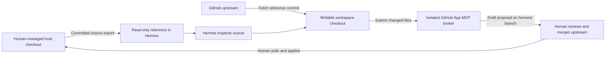

# Human-reviewed improvement workflow

The first target is `sevandewater/hermes-dev-loop`. Hermes may read its committed
source and prepare improvements, while the human retains merge authority and
control of the live host deployment.

## Local workflow implemented

The host exports committed HEAD into ignored `runtime/reference/`, mounted
read-only at `/reference`. The project is available at
`/reference/hermes-dev-loop`; `.devloop-reference.json` records its exact commit.
Exports omit worktree edits and untracked files. Host `.git`, local `.env`,
runtime data, SSH/AWS credentials and links are never copied into the reference.
Tracked protected paths or links cause an export failure, preserving the prior
reference. This is a committed-source export, not an arbitrary-secret scanner:
secrets must never be committed under an ordinary source filename either.

Host `./devloop` has a **project** submenu for status, reference refresh and
checkout preparation. `setup` and `rebuild` also refresh the reference.
Refreshing uses the current committed host HEAD and does not pull from GitHub.
The reference may therefore describe an unmerged feature commit. Compare its
revision with the intended PR base before developing a proposal.

`./devloop project --checkout` fetches that exact public GitHub commit into
`/workspace/projects/hermes-dev-loop`, using an independent Git repository and
branch `hermes/improvement`. It refuses an existing checkout. No host Git
configuration, credential helper, object store or hooks are shared. If the host
commit has not been pushed to GitHub, fetch fails until the human publishes it.
Later reference refreshes do not reset or overwrite the working checkout.

Inside Hermes, edit and test the workspace copy. Infrastructure definitions in
that copy are proposed source changes: they cannot change the running Compose
stack, networking policy or credential mounts. Docker-based integration/security
tests require the human administrator because Hermes has no Docker socket.

The original foundation is currently delivered in draft PR #1. Merge and pull
the approved foundation before using `main` as the base of subsequent improvements;
otherwise a proposal may unintentionally include the entire unmerged foundation.

## GitHub proposals through the App

The separate identity is `hermes-dev-loop-bot`, installed only for this project.
The [isolated broker](github-app-broker.md) holds its App key and delegates
authentication to GitHub's maintained MCP server. Hermes receives a restricted,
project-scoped MCP toolset through `github-devloop`, with no key, installation token, merge tool,
approval tool, generic API or host execution access.

Start/register the broker using the **github** submenu in `./devloop`, then start
a new Hermes chat. The broker can read repository files and PRs immediately.
Before proposal writes, its live policy requires an active PR rule on `main`
with at least one approval, code-owner review, stale-approval dismissal and no
App bypass. The repository keeps its bypass list empty, so the human owner
follows the same rules. The broker reports when GitHub hides the full list. The broker exposes no
merge operation; the App retains its underlying post-approval merge permission.

For an improvement, inspect the reference, develop and test in the workspace,
then create a `hermes/` proposal branch from `main`, submit changed text files
with `commit_proposal_files`, and open a draft through
`open_proposal_pull_request`. Local workspace Git operations do not receive App
credentials: publication happens through MCP rather than authenticated Git push.
Tools fix the owner/repository/base and reject protected files. Workflow changes
remain normally disabled. After the one-time premerge security prerequisites,
human merge, host pull and `./devloop github --start`, the host administrator may
use `./devloop github --workflows enable` only for authorized workflow-file edits,
then `./devloop github --workflows disable`. These controls apply and verify the
live broker without a manual restart; `--workflows status` separates configured
and live/unavailable state. They do not verify GitHub admin settings. Existing
CI execution and ordinary code proposals continue disabled. When enabled, only
the finite verification envelope is accepted through the existing commit tool,
with complete proposed-set validation. See [CI verification](ci-verification.md).
The foundation should reach `main` before functional improvements are proposed;
otherwise `main` lacks the code in the feature reference. Its CODEOWNERS file
assigns all files to the human owner and becomes effective on the base branch
after merge. The current foundation PR is authored by the human, so it needs
another eligible reviewer; App-authored proposals can be reviewed by the human.

`./devloop github --check` verifies actual reads and denial paths without remote
mutation. `./devloop github --proposal-test` explicitly creates a disposable
branch/commit/draft PR only if GitHub protection passes. Close the canary after
verification; never merge it as a test. Current protection and executed tests are
recorded in [broker validation](github-broker-validation.md).

## Human review and activation

A proposal should state the problem, implementation, tests actually executed,
tests requiring host execution, and any change to mounts, credentials or network
boundaries. The human decides whether to accept and merge it. Code merged into
GitHub does not automatically update or restart the local deployment.

After merge, the human pulls the approved branch locally and uses DevLoop to
refresh the reference and rebuild/restart services as needed. The bot has no host
checkout mount, deployment socket, automatic updater or host command runner.
New proposals that relax these controls deserve the same explicit review as
other infrastructure changes.

Hermes' existing writable home, tools, skills and workspace remain writable during
a session. This workflow gates adoption of host project changes; it does not make
every agent-owned tool or configuration edit require a PR.

## Validation

Committed-source exports, read-only mounts, writable independent checkout,
isolated App authentication, exact tool discovery, denied operations and
container boundaries have separate checks. See [foundation validation](security-validation.md)
for the original run and [broker validation](github-broker-validation.md) for the
current integration. Read success does not establish proposal creation or token
refresh; those outcomes are recorded separately.
