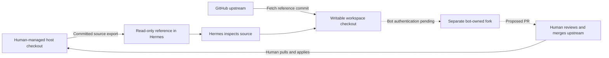

# Human-reviewed improvement workflow

The first target is `sevandewater/hermes-dev-loop`. Hermes may read its committed
source and prepare improvements, while the human retains merge authority and
control of the live host deployment.

## Local workflow implemented

The host exports committed HEAD into ignored `runtime/reference/`, mounted
read-only at `/reference`. The project is available at
`/reference/hermes-dev-loop`; `.devloop-reference.json` records its exact commit.
Exports omit worktree edits and untracked files. Host `.git`, local `.env`,
runtime data, SSH/AWS credentials and links are never copied into the reference.
Tracked protected paths or links cause an export failure, preserving the prior
reference. This is a committed-source export, not an arbitrary-secret scanner:
secrets must never be committed under an ordinary source filename either.

Host `./devloop` has a **project** submenu for status, reference refresh and
checkout preparation. `setup` and `rebuild` also refresh the reference.
Refreshing uses the current committed host HEAD and does not pull from GitHub.
The reference may therefore describe an unmerged feature commit. Compare its
revision with the intended PR base before developing a proposal.

`./devloop project --checkout` fetches that exact public GitHub commit into
`/workspace/projects/hermes-dev-loop`, using an independent Git repository and
branch `hermes/improvement`. It refuses an existing checkout. No host Git
configuration, credential helper, object store or hooks are shared. If the host
commit has not been pushed to GitHub, fetch fails until the human publishes it.
Later reference refreshes do not reset or overwrite the working checkout.

Inside Hermes, edit and test the workspace copy. Infrastructure definitions in
that copy are proposed source changes: they cannot change the running Compose
stack, networking policy or credential mounts. Docker-based integration/security
tests require the human administrator because Hermes has no Docker socket.

The original foundation is currently delivered in draft PR #1. Merge and pull
the approved foundation before using `main` as the base of subsequent improvements;
otherwise a proposal may unintentionally include the entire unmerged foundation.

## GitHub identity required before publishing

The human has now created and installed `hermes-dev-loop-bot`, a dedicated GitHub
App. This provides a separate identity without requiring another human GitHub
account. [App credential setup and the planned MCP broker](github-app-broker.md)
supersede the bot-account setup below. Remote publishing remains disabled until
the actual App ID/key, restricted broker and human-only merge enforcement have
been validated. The host's existing administrative GitHub identity is not reused.

The previously proposed public-repository fork workflow was:

1. Create or choose a dedicated GitHub bot account with no access to unrelated
   private repositories. The human retains account recovery and administration.
2. Fork `sevandewater/hermes-dev-loop` into that account. The bot writes only its
   fork's proposal branches as part of this workflow.
3. Keep the bot out of the upstream repository's collaborators and write/admin
   roles. A rule requiring a human review alone does not remove merge permission
   after that review; the bot must lack upstream write authority entirely.
4. Provision authentication locally under the bot identity. Do not paste tokens
   into chat or copy the human's SSH agent, credential helper or GitHub session.
   Credential delivery and automated PR publication require implementation and
   explicit validation after the bot identity is known.
5. Verify the authenticated actor is the intended bot, the fork's parent is the
   expected upstream, fork push is permitted, and upstream push/admin permissions
   are absent. Only then enable fork pushes and PR creation. Do not test the merge
   restriction by attempting to merge a real PR.

GitHub supports [PRs from forks](https://docs.github.com/en/pull-requests/how-tos/create-pull-requests/creating-a-pull-request-from-a-fork).
Its API distinguishes
[PR creation permissions from merge permissions](https://docs.github.com/en/rest/pulls/pulls):
the fine-grained merge endpoint requires Contents write. Token permissions do not
grant rights beyond the underlying account. A fork owned by the same human
administrator would not establish the intended identity boundary.

There is a current credential-design constraint:
[fine-grained PATs have limitations for contributions to public repositories outside their owner's membership](https://docs.github.com/en/authentication/keeping-your-account-and-data-secure/managing-your-personal-access-tokens).
Do not assume a token scoped only to the fork can also create the upstream PR.
Select and verify the authentication method for both operations before enabling
publishing; a classic bot token has broader scope, while an App needs a separately
reviewed installation/permission design. Neither method should expose the human's
existing account credentials.

The default egress allowlist currently omits `api.github.com`. Git clone/fetch
works through `github.com`; API-based PR publishing will need an explicit,
reviewed allowlist addition and repeated proxy/network checks. No API access was
added as part of preparing the source reference.

## Human review and activation

A proposal should state the problem, implementation, tests actually executed,
tests requiring host execution, and any change to mounts, credentials or network
boundaries. The human decides whether to accept and merge it. Code merged into
GitHub does not automatically update or restart the local deployment.

After merge, the human pulls the approved branch locally and uses DevLoop to
refresh the reference and rebuild/restart services as needed. The bot has no host
checkout mount, deployment socket, automatic updater or host command runner.
New proposals that relax these controls deserve the same explicit review as
other infrastructure changes.

Hermes' existing writable home, tools, skills and workspace remain writable during
a session. This workflow gates adoption of host project changes; it does not make
every agent-owned tool or configuration edit require a PR.

## Executed local validation

On 2026-10-20, all **40 local unit tests passed**, including real Git archive
exports that exclude uncommitted/untracked files, preserve executable modes,
reject committed private paths and links, and preserve the previous reference
after a rejected refresh. CLI tests cover project refresh, menu access and
container-only checkout orchestration alongside the existing administration cases.

Live `./devloop project --refresh`, service recreation with the read-only mount,
and `./devloop project --checkout` passed. The checkout fetched the public source
commit into its own Git repository without host Git state or GitHub credentials.

`./devloop test --persistence` exited zero with **25 passing check groups**, one
skipped real-account group and the existing accepted gateway egress exception.
The new group read the project source and confirmed EROFS on both an existing
source file and attempted creation under `/reference`; sensitive paths were absent.
The original network and writable-storage persistence checks also passed.

This run used an existing authenticated gateway for its local health check;
it did not perform OAuth, request a chat completion or claim provider refresh
validation. No bot credentials, fork pushes, PR creation or GitHub permission
denial tests have run. The merge restriction is a requirement of the pending
GitHub setup, not a control established by the local source mount.
