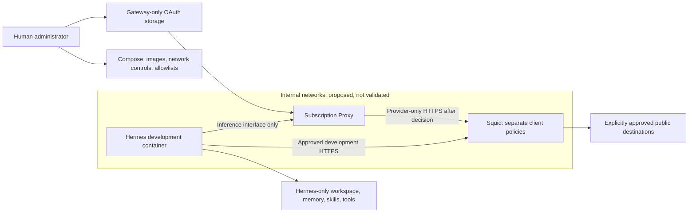

# Infrastructure foundation: architectural review

Reviewed on 2026-10-20. Status: **waiting for upstream proxy support**.

## Decision

The handoff's stop conditions apply to the interaction between functional
inference and enforced gateway egress. Keeping the gateway on internal networks
with only Squid access will break its current inference transport. Giving it an
ordinary external network restores connectivity but does not independently
restrict destinations. Environment settings alone do not bridge this gap.

This is a limitation of the unmodified component in a Squid-only topology, not a
claim that secure network isolation is impossible. No alternative authentication
broker, transport modification, host firewall rule, or deployable Compose file
has been implemented.

**Human decision, 2026-10-20: wait for upstream proxy support.** Infrastructure
implementation remains on hold. The local transport patch and host-managed
filtering alternative are not approved for implementation. The draft pull request
remains an unmerged record of the investigation and this decision.

When work resumes, inspect and pin a suitable upstream version that supports
inference through the designated proxy, then verify that behavior with a runtime
diagnostic. The current diagnostic is pinned to the historical source below and
must be reviewed and adapted for the new source; its existing result does not
establish behavior of a newer version. Validate Nous OAuth login and refresh
through the restricted route, then implement and execute the full foundation
acceptance checks. Upstream transport support alone does not prove network
isolation or account compatibility.

## Pinned upstream evidence

Repository: [NousResearch/hermes-agent](https://github.com/NousResearch/hermes-agent).
The locally fetched source was inspected at commit
[`e55c2662f5ebfbd3a474ebf5e0e0c51187e70e39`](https://github.com/NousResearch/hermes-agent/tree/e55c2662f5ebfbd3a474ebf5e0e0c51187e70e39).
The reviewed `hermes_cli/proxy/server.py` Git blob is
`49575154482db3d336b00501dc74dfb5b8711a89`.

| Question | Finding | Evidence |
| --- | --- | --- |
| Can it run without the agent loop? | Yes in source: the CLI starts the proxy server directly, without starting an agent session. | [proxy/cli.py](https://github.com/NousResearch/hermes-agent/blob/e55c2662f5ebfbd3a474ebf5e0e0c51187e70e39/hermes_cli/proxy/cli.py) |
| Does it support Nous Portal authentication? | The existing Nous adapter uses the Hermes OAuth credential resolver. This user's account entitlement and login have not been exercised. | [adapters/nous_portal.py](https://github.com/NousResearch/hermes-agent/blob/e55c2662f5ebfbd3a474ebf5e0e0c51187e70e39/hermes_cli/proxy/adapters/nous_portal.py) |
| Is its interface OpenAI compatible? | It exposes `/v1/chat/completions`, `/v1/completions`, `/v1/embeddings`, and `/v1/models`, forwarding responses and supporting streaming. End-to-end client compatibility remains untested. | [proxy/server.py](https://github.com/NousResearch/hermes-agent/blob/e55c2662f5ebfbd3a474ebf5e0e0c51187e70e39/hermes_cli/proxy/server.py) |
| Where do credentials persist? | `auth.json` in the gateway's Hermes home, plus a shared Nous store at `HERMES_SHARED_AUTH_DIR/nous_auth.json` when explicitly configured. Upstream otherwise derives a shared location. Both stores must remain gateway-only. | [auth.py](https://github.com/NousResearch/hermes-agent/blob/e55c2662f5ebfbd3a474ebf5e0e0c51187e70e39/hermes_cli/auth.py), [auth_nous.py](https://github.com/NousResearch/hermes-agent/blob/e55c2662f5ebfbd3a474ebf5e0e0c51187e70e39/hermes_cli/auth_nous.py) |
| How does refresh work? | The Nous adapter resolves current credentials and refreshes them through upstream code; it also supports a refresh/retry after an upstream 401. Store writes are atomic with restrictive permissions and locking. Refresh, restart recovery, and revocation handling have not been exercised here. | The auth and Nous adapter sources above |
| Does it obey `HTTP_PROXY` / `HTTPS_PROXY`? | Inference does not: `_open_upstream` constructs an aiohttp session without `trust_env=True` or an explicit proxy. OAuth uses a separate HTTPX client and must be validated separately. | The server and auth sources above; [aiohttp proxy documentation](https://docs.aiohttp.org/en/stable/client_advanced.html#proxy-support) |
| Can it remain isolated from Hermes? | Separate processes, filesystems, and persistent stores are compatible with its design. A secure, functional deployment still depends on upstream transport support and executing boundary tests. | Source inspection, not a verified deployment |

An OpenAI-compatible protocol does not establish OpenAI account access. Nous
subscription entitlements determine which models work through this route; no
separate OpenAI OAuth flow or API key is assumed or introduced.

## Deferred transport proposal, not approved or applied

The earlier proposal would change only the inference session construction in
`hermes_cli/proxy/server.py` at the pinned upstream commit. It is retained as
review evidence; the selected decision is to wait for upstream support:

```diff
-        session = aiohttp.ClientSession(timeout=aiohttp.ClientTimeout(total=None, sock_connect=15, sock_read=300))
+        session = aiohttp.ClientSession(trust_env=True, timeout=aiohttp.ClientTimeout(total=None, sock_connect=15, sock_read=300))
```

The gateway's proxy settings would be human-controlled. The patch makes inference
able to use Squid; network restrictions must independently prevent direct access.
`NO_PROXY` must not exempt provider hosts. The build must verify the upstream pin
and fail if the patch no longer matches. No runtime monkey-patching is proposed.

This does not modify authentication, add a broker, or establish a working OAuth
deployment by itself. Login, refresh, streaming, failure behavior, and credential
redaction remain acceptance checks.

## Considered alternatives

| Approach | Benefit | Cost and unresolved work |
| --- | --- | --- |
| Pinned transport patch, not selected | Retains existing Nous OAuth and three primary services; gateway requests can use Squid. | Maintain and test a small upstream patch; enforce provider-only Squid ACLs for the gateway. |
| Unmodified proxy with human-administered host firewall | Retains upstream transport unchanged. | Design and verify destination enforcement outside the proxy, including changing provider IPs, IPv6, DNS, host input, Docker forwarding, and rules across restarts. No host firewall has been changed. |
| Wait for upstream proxy support, selected | Avoids carrying a local patch. | Foundation remains on hold until a reviewed upstream version supports the required transport. |

Unrestricted gateway internet access, privileged networking containers, and
passing provider credentials to Hermes are not acceptable resolutions.

## Intended trust boundaries, not deployed



Only Squid would join an external network in the patched approach. Separate
internal networks and source-specific Squid policies must keep the gateway
restricted to reviewed Nous endpoints rather than the development allowlist.
No listening port would be published on the host. Hermes would have no Docker
socket, elevated capabilities, writable root filesystem, infrastructure mount,
or gateway-state mount. Its default process would remain idle; a human would
explicitly launch interactive development.

Docker internal networks alone are insufficient evidence of all required
boundaries. In particular, host reachability, embedded DNS, IPv6, and reachable
peer interfaces require explicit enforcement and adversarial runtime validation.
Docker documents that an ordinary internal network can still reach services on
its gateway address: [internal network behavior](https://docs.docker.com/reference/cli/docker/network/create/#network-internal-mode---internal).
The exact host/Docker controls have not yet been selected or tested. No host
network settings should be changed until that configuration is reviewable.

### Proposed storage ownership

| Repository path | Administrator | Future container access |
| --- | --- | --- |
| `compose.yaml`, `infrastructure/`, `tests/`, `docs/` | Human | No repository-root mount into Hermes; config mounts only into their owning services, read-only |
| `runtime/hermes/workspace/` | Hermes | Writable, executable development files |
| `runtime/hermes/memory/`, `skills/`, `tools/` | Hermes | Writable persistent data |
| `runtime/gateway/` | Human and gateway process | Gateway-only persistence; no parent runtime mount into Hermes |
| `.env` | Human | Non-secret settings only; never pass provider credentials to Hermes |

The entire runtime tree is Git-ignored. Directory isolation must be achieved by
selective mounts, not just host Unix permissions or different filenames. Gateway
home and shared-auth paths must both remain inside its private persistent mount.
Secrets must not enter image layers, Compose environment definitions, test output,
or committed files. Redaction during OAuth failures needs explicit verification.

## Human authentication procedure after upstream support is available

The operator will authenticate using the existing Nous OAuth command
`hermes auth add nous --type oauth` inside the gateway's private environment,
then launch `hermes proxy start --provider nous` on the designated internal
interface. Device-code approval, where offered, must be completed by the operator
in the browser. Container command wrappers and network access for this procedure
remain to be implemented and tested; these are upstream command names, not setup
instructions for a working stack in this repository.

Do not paste tokens into chat or copy an existing agent's entire home directory.
Configure both gateway credential stores before login. Confirm account
entitlements through `/v1/models` and a deliberate inference test after login;
neither this review nor a successful login proves access to every model.

## Usage controls and remaining risks

The upstream proxy does not authenticate its inference clients with a private
client secret. Any non-browser client that reaches the interface can consume the
subscription. Browser origin protections are not client authentication.

There is no independently enforced per-agent request rate, token budget, or
spending ceiling in the reviewed proxy. Provider-side tier limits are not a
human-controlled local budget. A compromised Hermes process could exhaust the
available subscription quota through its authorized gateway interface. Network
isolation does not solve that risk. Autonomous execution remains out of scope.

Squid's destination allowlist will still allow exchange of data with approved
destinations. HTTPS CONNECT hides application traffic from a conventional proxy;
an allowlist is not a guarantee against misuse of permitted services. Broad
wildcards and provider destinations must be reviewed carefully.

## Validation ledger

Results must distinguish source review, a diagnostic reproduction, configured
controls, and actual runtime verification.

| Check | Status |
| --- | --- |
| Repository default branch | Confirmed `main` using GitHub metadata |
| Upstream source pin and transport inspection | Executed against the commit and blob above |
| Docker client and server availability | Executed: Engine 29.8.1; daemon readable through approved execution scope |
| Compose CLI availability | Executed: Compose v5.5.1 |
| Local transport diagnostic | See `tests/README.md` for the executed result and its narrow scope |
| Compose configuration validation | Not run: no deployable configuration, waiting for upstream support |
| Required service image builds and startup | Not run: implementation on hold by human decision |
| All requested network and filesystem boundary tests | Not run: no foundation deployed |
| Persistent storage across recreation | Not run: no persistent service storage configured |
| Nous OAuth login, refresh, inference connectivity | Not run: human authentication and deployed gateway unavailable |
| Security review of a completed implementation | Pending; this review only assesses feasibility and the gateway seam |

Acceptance when implementation resumes must cover every handoff test, plus TCP and UDP DNS
(including Docker's embedded resolver), IPv6, proxy bypass with environment
variables removed, nonstandard ports/protocols, literal-IP and private-host proxy
requests, DNS rebinding to prohibited addresses, gateway policy separation, mount
and symlink escape attempts, and the absence of a usable Docker socket. Negative
network tests need reachable positive controls or host-side observation so a
timeout alone cannot masquerade as enforced isolation. Config and credential
tests must use host-created canaries and mount inspection, not just check whether
guessed paths are absent. Gateway health is distinct from authenticated inference.

After implementation, the operator still needs documented setup, lifecycle,
allowlist updates, log review, backup, and repeatable security-test commands.
Those procedures cannot be truthfully supplied as working instructions before
upstream support is available and the stack exists.
